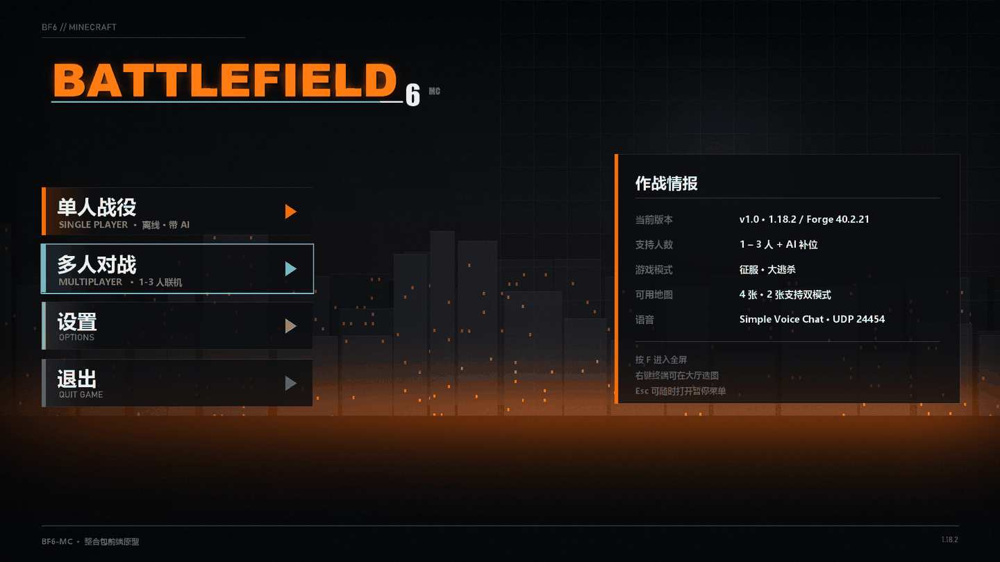
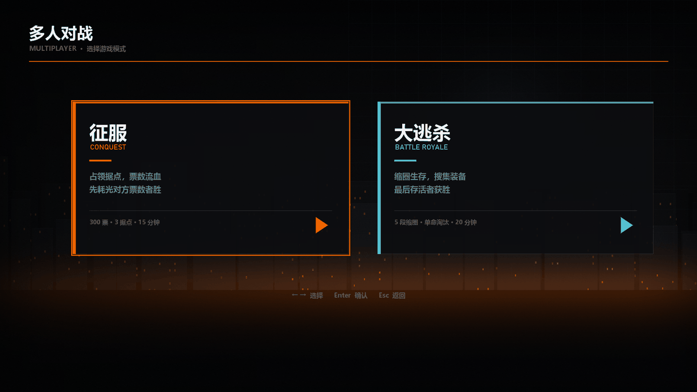
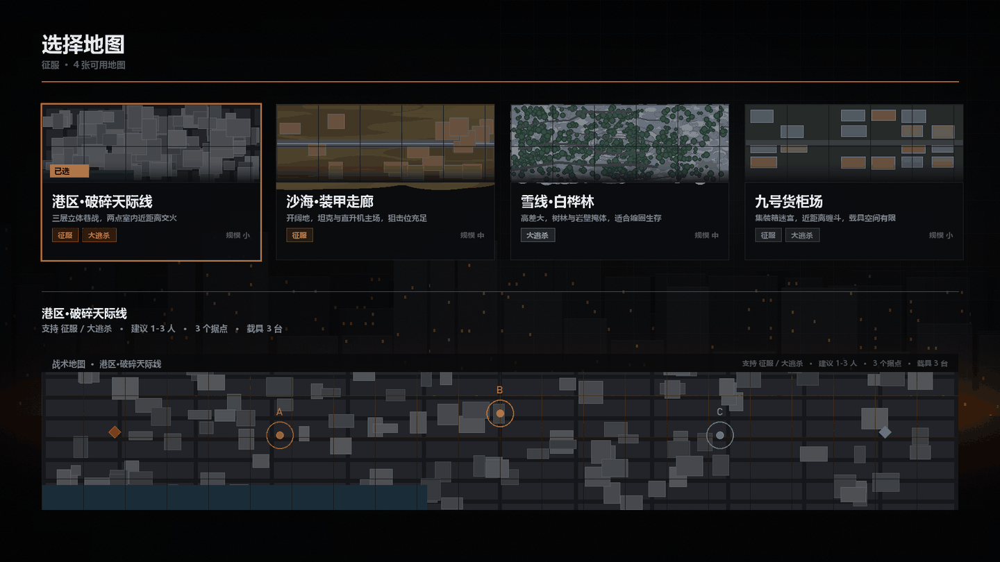
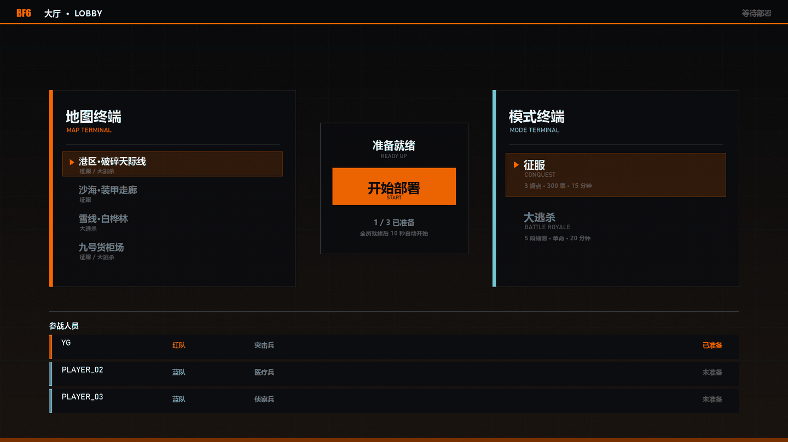
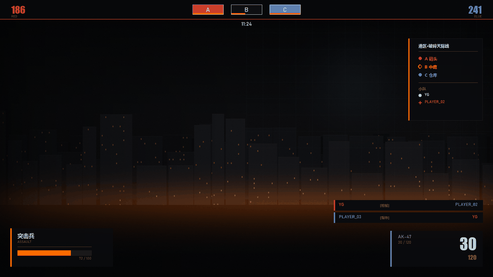
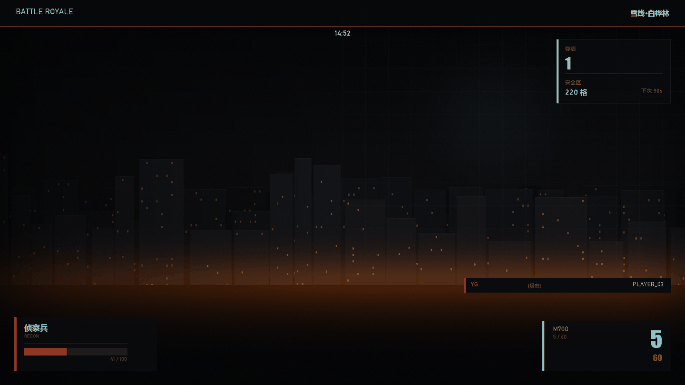
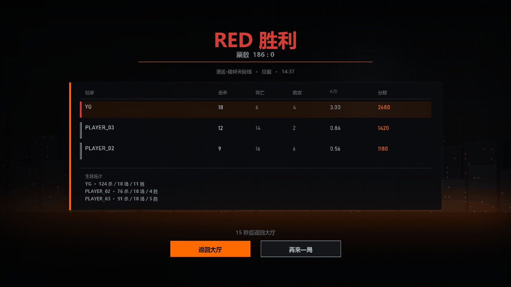

# BF6-MC · 战地 6 风格 Minecraft 整合包

[](#)
[](#)
[](#)
[](#)
[](LICENSE)

MC **1.18.2** / Forge **40.2.21** / Java **17** — 1–3 人 + AI 补位，完整复刻战地 6 流程。

```
主菜单 → 单人/多人 → 模式选择 → 地图选择 → 大厅 → 征服 / 大逃杀 → 结算 → 回大厅
```

> **前端已完成可直接用**（25 张 UI 素材 + 7 张效果图）。
> **后端是 KubeJS 单文件原型**，跑得通但地图地形、枪械 ID、载具 ID 需按 `docs/` 标定。

---

## 效果图

| | |
|---|---|
|  |  |
| **主菜单** | **模式选择** |
|  |  |
| **地图选择（4 张战术图）** | **大厅（选图 + 选模式 + 准备）** |
|  |  |
| **局内 HUD · 征服** | **局内 HUD · 大逃杀** |
|  | |
| **结算** | |

---

## 快速开始

### 1. 装模组（22 个）

见 [`MODLIST.md`](MODLIST.md)。核心 17 个 + 性能 5 个，版本号照抄。

关键文件：

```
tacz-1.18.2-1.1.4-hotfix2.jar
Immersive Vehicles-1.18.2-24.0.0.jar
PlayerRevive_FORGE_v2.0.14_mc1.18.2.jar
firstaid-1.11.2.jar
ParCool-1.18.2-3.4.3.3.jar
recruits-1.18.2-1.13.2.jar
fancymenu_forge_3.7.0_MC_1.18.2.jar
kubejs-forge-1802.5.5-build.569.jar
voicechat-forge-1.18.2-2.6.22.jar
```

### 2. 放前端素材

```
fancymenu/assets/*.png  →  .minecraft/config/fancymenu/assets/
```

然后在游戏里按 [`fancymenu/README.md`](fancymenu/README.md) 搭 3 个布局（主菜单 / 模式 / 地图），点几下就行。

### 3. 放玩法脚本

```
kubejs/server_scripts/bf6.js  →  .minecraft/kubejs/server_scripts/bf6.js
```

单文件，65 KB。启动一次服务器，KubeJS 自动创建目录结构。

### 4. 验证

进单人 → 创建超平坦世界 → 应被传送到 y=200 虚空大厅：

- 右侧讲台 = 选地图
- 左侧讲台 = 选模式
- `/bf6 ready` 开始
- 10 秒简报 → 进入对局

---

## 目录

```
bf6/
├── README.md                  本文件
├── MODLIST.md                 模组清单（含排除项与理由）
├── kubejs/
│   └── server_scripts/
│       └── bf6.js             全部玩法逻辑（单文件）
├── fancymenu/
│   ├── README.md              FancyMenu 落地步骤
│   ├── UI-SPEC.md             完整设计规范
│   ├── assets/                25 张可直接用的 PNG
│   └── mockups/               7 张效果图
├── config/
│   ├── README.md              各 mod 的推荐配置
│   ├── start-server.bat       Windows 服务端启动脚本
│   └── start-server.sh        Linux/macOS 启动脚本
├── docs/
│   ├── 01-安装.md             逐步安装 + 故障对照表
│   ├── 02-地图标定.md         把占位坐标换成真实坐标
│   └── 03-键位.md             推荐键位（避免 mod 冲突）
└── scripts/
    ├── gen_all.py             重出 25 张 UI 素材
    ├── gen_mockups.py         重出 7 张效果图
    └── check-install.ps1      安装自检（Java/Forge/Mod/脚本/素材/配置）
```

---

## 已实现

### 前端（全部完成）

| 界面 | 状态 | 交付物 |
|---|---|---|
| 主菜单 | ✅ | `background.png` + `logo.png` + 4 按钮 + `card_info.png` |
| 模式选择 | ✅ | `card_mode_conquest.png` + `card_mode_br.png` |
| 地图选择 | ✅ | 4 张地图卡 + 4 张战术俯视图 |
| 大厅 | ✅ | `lobby_bg.png` + 三栏布局 |
| HUD · 征服 | ✅ | 顶条 / 据点条 / 兵种卡 / 弹药卡 / 击杀播报 / 侧栏 |
| HUD · 大逃杀 | ✅ | 顶条 / 存活缩圈面板 / 兵种 / 弹药 |
| 结算 | ✅ | `result_header.png` + 记分板 |

### 玩法（后端，待完善）

| 功能 | 状态 |
|---|---|
| 4 张地图注册表 | ✅ |
| 大厅（虚空平台 + 双终端） | ✅ |
| 地图 / 模式投票 | ✅ |
| 10 秒部署简报 | ✅ |
| 征服：3 点占领 + 争夺冻结 | ✅ |
| 征服：票数流血 | ✅ |
| 征服：5 秒重生 | ✅ |
| 征服：5 兵种装备表 | ✅ |
| 大逃杀：5 段缩圈 | ✅ |
| 大逃杀：空投 | ✅ |
| 大逃杀：单命淘汰 | ✅ |
| AI 补位（Villager Recruits） | ✅ |
| 结算 + 生涯统计 | ✅ |
| 击杀播报 + 连杀 | ✅ |
| 倒地 / 救援 | ✅ |
| Sidebar 计分板 | ✅ |
| 地图实际地形 | ❌ 需自建，见 `docs/02-地图标定.md` |

---

## 命令

| 命令 | 权限 | 作用 |
|---|---|---|
| `/bf6 start conquest` | OP | 开一局征服 |
| `/bf6 start br` | OP | 开一局大逃杀 |
| `/bf6 map urban` | OP | 锁定地图 |
| `/bf6 vote map <id>` | 所有人 | 投票地图 |
| `/bf6 vote mode <id>` | 所有人 | 投票模式 |
| `/bf6 ready` | OP | 全员就绪 |
| `/bf6 class <id>` | 所有人 | 切兵种 |
| `/bf6 bot <n> <team>` | OP | 加 AI |
| `/bf6 stop` / `/bf6 lobby` | OP | 中止对局 → 15 秒结算 → 自动回大厅 |
| `/bf6 status` | OP | 查状态 |

兵种 id：`assault` / `engineer` / `support` / `recon` / `medic`
地图 id：`urban` / `desert` / `alpine` / `industrial`

---

## 已知限制

1. **地图坐标是占位值**。`bf6.js` 里 4 张图用 `8000/16000/24000/32000` 为方块坐标原点各占一块，地形要自建或用 WorldEdit 贴。见 `docs/02-地图标定.md`。

2. **TaCZ 枪械 ID 是推测的**（`tacz:ak47` / `tacz:mp5` / `tacz:m249` / `tacz:m700` / `tacz:ump45`）。首次进游戏先 `/give @s tacz:modern_kinetic_gun` 看实际 ID，再改 `LOADOUTS`。

3. **IV 载具实体 ID 也是推测的**（`iv:mtank` / `iv:car` / `iv:heli`）。用 `/summon iv:` Tab 补全确认后改 `vehicles` 数组。

4. **AI 不会主动占点**。Villager Recruits 会寻路、射箭、举盾、编队，但征服模式的据点推进仍靠玩家。AI 只提供人头压力。

5. **FancyMenu 布局不能脚本生成**（二进制格式），必须游戏内搭。素材已备好。

6. **1.18.2 的 actionbar 只有一个槽位**，所以模式 HUD 用 actionbar，队伍状态并入 sidebar。

---

## 联机

| 方案 | 适用 | 语音 |
|---|---|---|
| e4mc | 1–3 人快速测试 | ❌ 只转 TCP |
| 专用服务器 | 推荐 | ✅ 放行 UDP 24454 |
| ZeroTier / Tailscale | 免端口映射 | ✅ |

服务端 `server.properties` 必改：

```properties
allow-flight=true          # IV 直升机 + ParCool 滑翔
view-distance=8
simulation-distance=6
spawn-protection=0
```

---

## 重出素材

```bash
python scripts/gen_all.py        # 25 张 UI 素材
python scripts/gen_mockups.py    # 7 张效果图
```

配色、地图地形、卡片文案都在 `scripts/gen_all.py` 顶部的常量里改。
