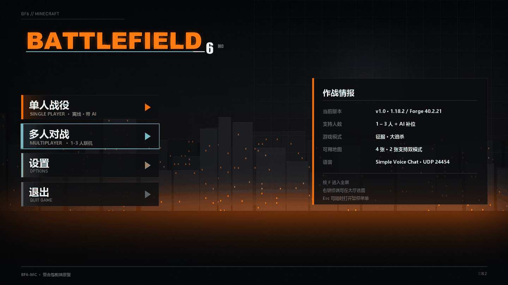
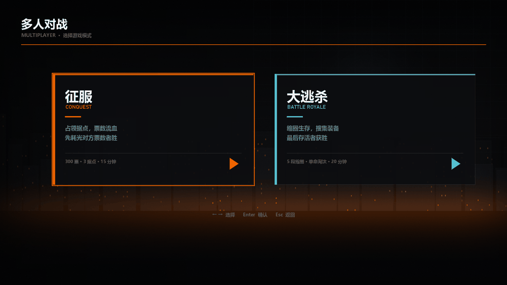
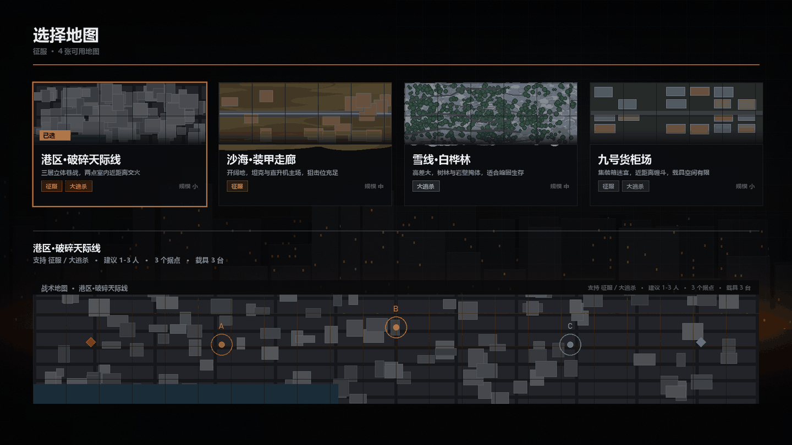
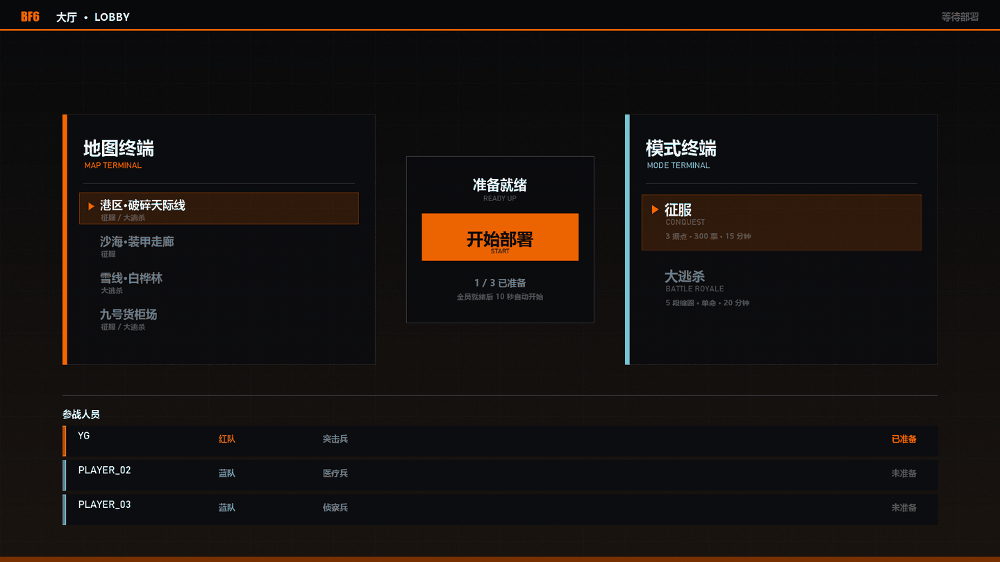
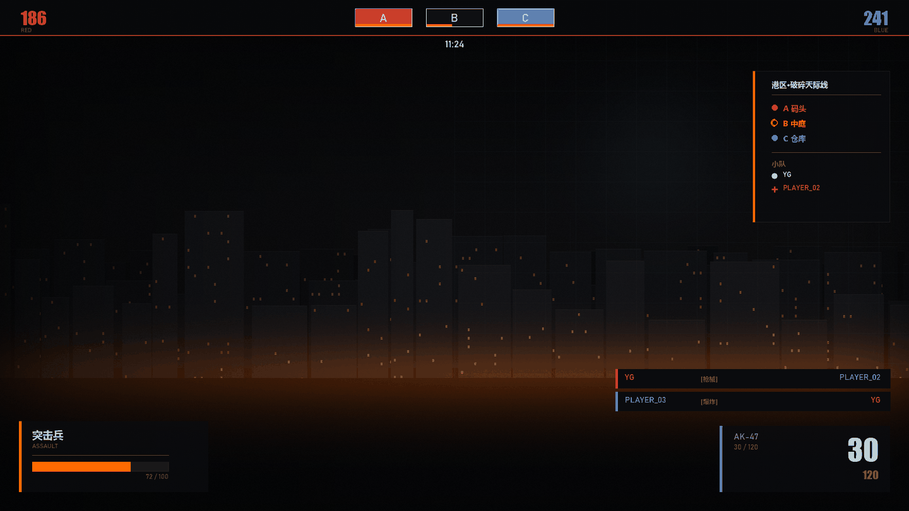
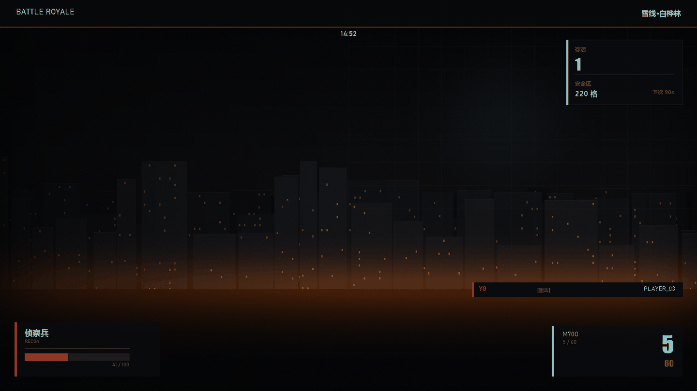
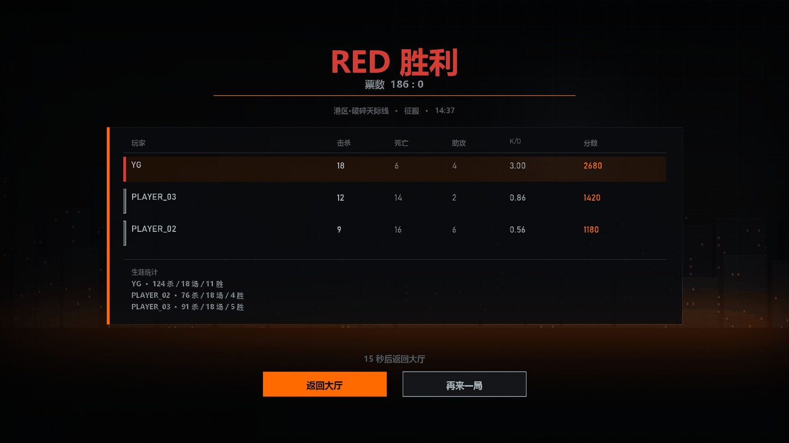

# BF6-MC 前端

MC 1.18.2 战地 6 风格整合包的前端部分：主菜单 → 模式 → 地图 → 大厅 → 局内 HUD → 结算。

**所有图片都已生成好，可直接用。** 不需要跑脚本，除非你要改配色或改地图。

---

## 效果图

| 屏 | 预览 |
|---|---|
| 主菜单 |  |
| 模式选择 |  |
| 地图选择 |  |
| 大厅 |  |
| 局内 HUD · 征服 |  |
| 局内 HUD · 大逃杀 |  |
| 结算 |  |

---

## 素材清单（`assets/`，22 个 PNG）

### 背景与标识

| 文件 | 尺寸 | 用途 |
|---|---|---|
| `background.png` | 1920×1080 | 主菜单 / 模式 / 地图 / HUD 通用背景 |
| `lobby_bg.png` | 1920×1080 | 大厅 / 结算背景 |
| `logo.png` | 1278×282 | BF6 字标 |
| `scanline.png` | 16×16 | 扫描线叠加（可平铺） |

### 按钮

| 文件 | 尺寸 | 绑定 |
|---|---|---|
| `btn_single.png` | 520×92 | → 单人 / 创建世界 |
| `btn_multi.png` | 520×92 | → 多人 / 模式选择 |
| `btn_settings.png` | 520×92 | → 选项 |
| `btn_quit.png` | 520×92 | → 退出 |

### 卡片

| 文件 | 尺寸 | 用途 |
|---|---|---|
| `card_info.png` | 664×480 | 主菜单右侧「作战情报」 |
| `card_mode_conquest.png` | 760×420 | 征服卡 |
| `card_mode_br.png` | 760×420 | 大逃杀卡 |
| `card_map_urban.png` | 420×300 | 港区地图卡 |
| `card_map_desert.png` | 420×300 | 沙海地图卡 |
| `card_map_alpine.png` | 420×300 | 雪线地图卡 |
| `card_map_industrial.png` | 420×300 | 货柜场地图卡 |

### 战术地图

| 文件 | 尺寸 | 内容 |
|---|---|---|
| `map_urban_tactical.png` | 1760×300 | 城市街区 + 水域 + A/B/C 据点 + 双出生点 |
| `map_desert_tactical.png` | 1760×300 | 沙丘 + 公路 + A/B/C 据点 |
| `map_alpine_tactical.png` | 1760×300 | 雪原 + 白桦林 + 岩壁 + 安全区等高线 |
| `map_industrial_tactical.png` | 1760×300 | 集装箱矩阵 + 轨道 + A/B/C 据点 |

据点状态配色：**红=RED 持有 / 橙=争夺中 / 蓝=BLUE 持有**。
出生点用菱形：红菱形=RED 出生，蓝菱形=BLUE 出生。

### HUD 底板

| 文件 | 尺寸 | 用途 |
|---|---|---|
| `hud_topbar.png` | 1920×76 | 局内顶条 |
| `hud_class.png` | 400×150 | 左下兵种/血量卡 |
| `hud_ammo.png` | 360×140 | 右下弹药卡 |
| `hud_sidebar.png` | 290×320 | 右侧战况栏 |
| `hud_br_panel.png` | 320×180 | 大逃杀存活/缩圈面板 |
| `result_header.png` | 1000×220 | 结算头部（胜负 + 票数） |

⚠️ HUD 底板**只有框和强调条**，数字/文字由 KubeJS 动态填。
`result_header.png` 是示例内容（RED 胜利 / 186:0），实际应由脚本画。

---

## 落地到 FancyMenu

FancyMenu 只能管**菜单**，不能进游戏世界。分工：

| 界面 | 由谁渲染 | 怎么接 |
|---|---|---|
| 主菜单 | FancyMenu | 见下方步骤 |
| 模式选择 | FancyMenu | 独立布局，绑在 Multiplayer 屏 |
| 地图选择 | FancyMenu | 独立布局 |
| 大厅 | **KubeJS** | 世界内的虚空平台 + sidebar + title |
| 局内 HUD | **KubeJS** | title / actionbar / scoreboard |
| 结算 | **KubeJS** | title + 聊天框表格 |

### 主菜单步骤

1. 游戏内打开主菜单 → 顶部菜单栏 **Customization**
2. 点 `Current Screen Customization: Disabled` 打开
3. `Layouts` → `New` → `For Current Screen`
4. 右键空白 → `Menu Background` → `Custom Background` → 选 `background.png`，模式 **Stretch**
5. 右键空白 → `New Element` → `Image`，逐个添加：

| 资源 | 锚点 | X | Y | 宽 |
|---|---|---|---|---|
| `logo.png` | Top Left | 76 | 96 | 792 |
| `btn_single.png` | Top Left | 80 | 360 | 520 |
| `btn_multi.png` | Top Left | 80 | 470 | 520 |
| `btn_settings.png` | Top Left | 80 | 580 | 520 |
| `btn_quit.png` | Top Left | 80 | 690 | 520 |
| `card_info.png` | Top Left | 1180 | 296 | 664 |
| `scanline.png` | Top Left | 0 | 0 | 平铺全屏，透明度 0.12 |

6. 每个按钮右键 → `Manage Actions` → `Add Action`：

| 图片 | Action |
|---|---|
| `btn_single.png` | `Open Screen` → `Singleplayer` |
| `btn_multi.png` | `Open Screen` → `Multiplayer` |
| `btn_settings.png` | `Open Screen` → `Options` |
| `btn_quit.png` | `Quit Game` |

7. 右键原版的 5 个按钮（Singleplayer / Multiplayer / Realms / Options / Quit）→ `Hide Element`

⚠️ 先把 `设置 → 视频设置 → GUI 缩放` 锁死（推荐 3），再排布局。
换分辨率时 FancyMenu 会自动缩放，但没锁 GUI 缩放会错位。

### 模式选择步骤

在 Multiplayer 屏建布局：

| 资源 | X | Y |
|---|---|---|
| `card_mode_conquest.png` | 200 | 280 |
| `card_mode_br.png` | 1040 | 280 |

- 征服卡 → Action `Run Command` → `/bf6 start conquest`（仅房主有效）
- 大逃杀卡 → Action `Run Command` → `/bf6 start br`

⚠️ 联机时客户端按这两个只会本地执行失败，应该改成 `Join Server` 或让服主用命令。

### 地图选择步骤

| 资源 | X | Y |
|---|---|---|
| `card_map_urban.png` | 80 | 200 |
| `card_map_desert.png` | 530 | 200 |
| `card_map_alpine.png` | 980 | 200 |
| `card_map_industrial.png` | 1430 | 200 |
| `map_<id>_tactical.png` | 80 | 680 |

四张战术图叠在同一位置，用 **Loading Requirements** 控制只显示选中的那张
（Requirement 类型 `Is Text` 比较某个变量，或用四个独立的按钮切换布局）。

---

## 改配色 / 重出图

```bash
python scripts/gen_all.py        # 重出 assets/ 全部 22 张
python scripts/gen_mockups.py    # 重出 mockups/ 7 张效果图
```

配色在 `scripts/gen_all.py` 顶部：

```python
ORANGE = (255, 106, 0)   # 主强调
CYAN   = (60, 200, 220)  # 次强调
RED    = (214, 62, 52)   # RED 队
BLUE   = (58, 132, 214)  # BLUE 队
```

改地图地形在 `MAPS` 字典和 `draw_terrain()`：

```python
MAPS = {
    'urban': {
        'name': '港区·破碎天际线',
        'terrain': 'city',      # city / desert / alpine / industrial
        ...
    }
}
```

新增地图：在 `MAPS` 加一项，`gen_all.py` 会自动出卡片和战术图。
KubeJS 那边要同步在 `01_maps_lobby.js` 的 `global.BF6.maps` 加同 id 的条目。

---

## 设计规范

完整规范（字号、间距、色值、每个元素坐标）见 [`UI-SPEC.md`](UI-SPEC.md)。

核心约定：

- 页面外边距 `80px`
- 卡片左侧一条 `6–8px` 纯色竖条（**不要省**，这是整套 UI 的识别特征）
- 分隔线用白色 12% 透明度，`1px`
- 中文用微软雅黑 Bold，西文大数字用 Impact
- 选中态用 `2–3px` 强调色描边，不用填充

---

## 文件结构

```
fancymenu/
├── README.md          本文件
├── UI-SPEC.md         完整设计规范
├── assets/            22 张可直接用的 PNG
└── mockups/           7 张效果图（给人看的，不用装进游戏）
```
