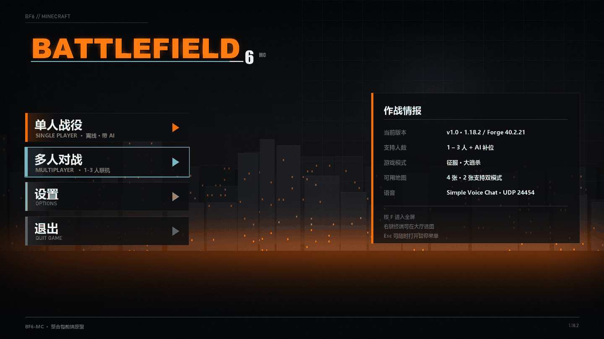
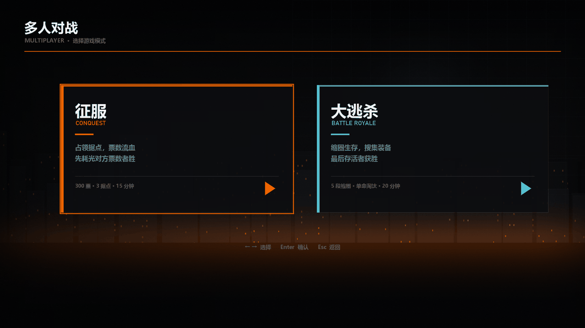
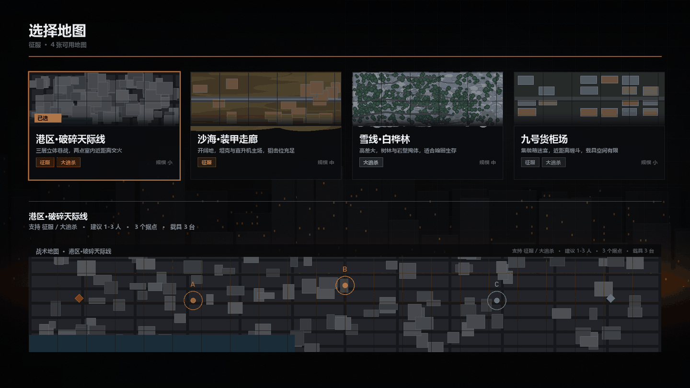
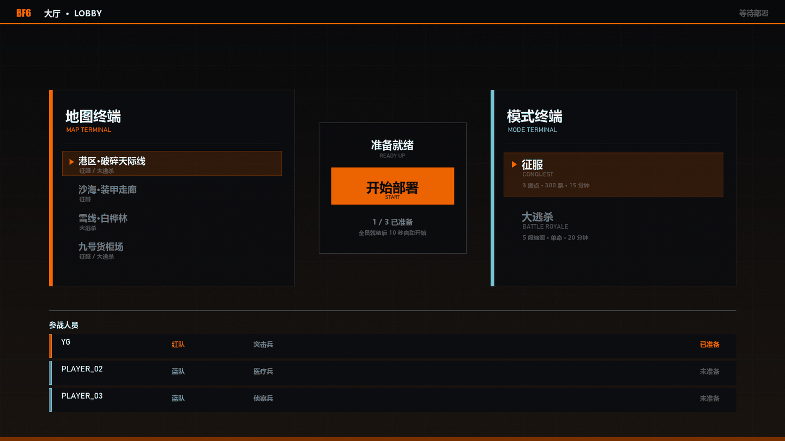
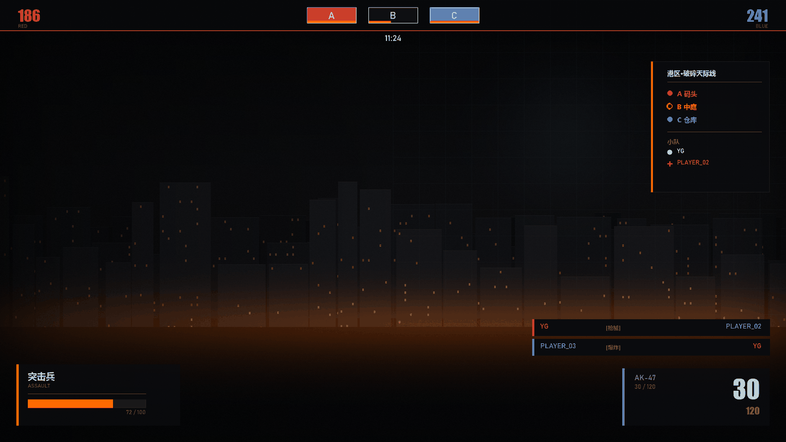

# BF6-MC 前端设计稿与规格

六屏全部按 **1920×1080** 渲染，实际文件在 `mockups/`。
配色、间距、字号都可直接照抄到 FancyMenu 布局或自绘 GUI。

---

## 视觉规范

### 色板

| 名称 | 值 | 用途 |
|---|---|---|
| 背景黑 | `#0A0B0D` | 主背景 |
| 面板黑 | `#0D0E11` @ 85% | 卡片/条 |
| 主橙 | `#FF6A00` | 主强调、选中态、进度 |
| 亮橙 | `#FFA83C` | 高光、hover |
| 冷青 | `#3CC8DC` | 次要强调、K/D、大逃杀 |
| 白 | `#EEF0F2` | 主文字 |
| 灰 | `#80848A` | 次要文字 |
| 暗灰 | `#565A60` | 辅助文字、分隔线 |
| 红队 | `#D63E34` | RED |
| 蓝队 | `#3A84D6` | BLUE |

### 字体

| 场景 | 字体 | 说明 |
|---|---|---|
| 中文标题 | 微软雅黑 Bold | 游戏内对应 Minecraft 自带 unicode 字体 |
| 西文大数字 | Impact / Arial Black | 票数、弹药、比分 |
| 西文正文 | Bahnschrift / 等宽 | 副标题、meta |

⚠️ **游戏内实现时不要指望这些字体**。MC 只有两种字体：默认像素字体 + unicode 字体。
上面的设计稿是"目标效果"，实际落地用 MC 的 `§` 颜色码 + 字号缩放来逼近，
大数字靠 **标题（title）** 的 scale 参数放大，而不是换字体。

### 间距

- 页面外边距：`80px`
- 卡片间距：`30px`（地图卡）/ `80px`（模式卡）
- 卡片内边距：`46px`
- 分隔线到内容：`24px`
- 标题到副标题：`8px`

### 强调条

所有卡片左侧一条 `6–8px` 宽的纯色竖条，颜色随语义（橙=主 / 青=次 / 队色=阵营）。
这是整套 UI 最统一的识别特征，**不要省**。

---

## 01 主菜单



### 布局

| 元素 | 位置 | 尺寸 |
|---|---|---|
| 左上角 `BF6 // MINECRAFT` | `80, 44` | 字号 17 |
| 短分隔线 | `80, 72` → `470` | 1px，暗灰 47% |
| LOGO | `76, 96` | 缩放 0.62（原图 1278×282 → 792×175） |
| 按钮 1 单人 | `80, 360` | 520×92 |
| 按钮 2 多人 | `80, 470` | 520×92 |
| 按钮 3 设置 | `80, 580` | 520×92 |
| 按钮 4 退出 | `80, 690` | 520×92 |
| 信息卡 | `1180, 296` → `1844, 776` | 664×480 |
| 底部状态线 | `80, 1010` → `1840` | 1px |
| 底部左文字 | `80, 1030` | 字号 15 |
| 底部右版本 | `1840, 1030` 右对齐 | 字号 15 |

### 选中态

当前项外框 `2px` 青色 `#3CC8DC`，其余无框。

### 信息卡内容

```
作战情报
────────────────────────────
当前版本    v1.0 · 1.18.2 / Forge 40.2.21
支持人数    1 – 3 人 + AI 补位
游戏模式    征服 · 大逃杀
可用地图    4 张 · 2 张支持双模式
语音        Simple Voice Chat · UDP 24454
────────────────────────────
按 F 进入全屏
右键终端可在大厅选图
Esc 可随时打开暂停菜单
```

---

## 02 模式选择



### 布局

| 元素 | 位置 |
|---|---|
| 标题 `多人对战` | `80, 60`，字号 44 |
| 副标 | `80, 120`，字号 18 |
| 分隔线 | `80, 168` → `1840`，2px 橙 63% |
| 卡 1 征服 | `x=200, y=280`，760×420 |
| 卡 2 大逃杀 | `x=1040, y=280`，760×420 |
| 底部提示 | 居中 `y=800`，字号 18 |

### 卡片内部（相对卡片左上角）

```
+46, +48   中文名（字号 52）
+48, +116  英文名（字号 20，橙/青）
+46, +160  短横线 60×4
+46, +190  描述第 1 行（字号 22，灰）
+46, +226  描述第 2 行
+46, +300  分隔线（到 -46）
+46, +320  meta 行（字号 17，暗灰）
右下 -90,-80  三角箭头 40×44
```

### 文案

| 卡 | 名称 | 副标 | 描述 | meta |
|---|---|---|---|---|
| 1 | 征服 | CONQUEST | 占领据点，票数流血 / 先耗光对方票数者胜 | 300 票 · 3 据点 · 15 分钟 |
| 2 | 大逃杀 | BATTLE ROYALE | 缩圈生存，搜集装备 / 最后存活者获胜 | 5 段缩圈 · 单命淘汰 · 20 分钟 |

---

## 03 地图选择



### 布局

| 元素 | 位置 |
|---|---|
| 标题 | `80, 56`，字号 40 |
| 副标（含当前模式） | `80, 112`，字号 17 |
| 分隔线 | `80, 156` → `1840`，2px |
| 卡片行 | `y=200`，4 张，每张 420×300，间距 30，起始 `x=80` |
| 详情分隔线 | `80, 560` → `1840` |
| 详情标题 | `80, 586`，字号 22 |
| 详情 meta | `80, 620`，字号 16 |
| 预览大图 | `80, 680` → `1840, 980` |

### 地图卡内部

```
+1,+1 → -1,+150   缩略图区（无图时用 22px 间距的斜线纹理填充）
+16,+116          选中标记（橙底 74×24，"已选"）
+20,+168          地图名（字号 26）
+20,+208          描述（字号 15，灰）
+20,+238          模式标签（每个宽 = 20 + 字数×15，高 26）
右下 -20,+242     规模标签（右对齐）
```

### 模式标签配色

标签底色 = 该模式的强调色 @ 16%，描边 @ 51%，文字 @ 100%。

### 预览区据点标记

- 圆环半径 26，`2px` 描边
- 圆心实心圆半径 7
- 标签字母在圆上方 52px，字号 20

---

## 04 大厅



### 顶部条

| 元素 | 位置 |
|---|---|
| 背景 | `0,0 → 1920,56`，`#08090B` @ 92% |
| 底边橙线 | `0,56 → 1920,58` |
| `BF6` | `40, 16`，字号 24，橙色 |
| `大厅 · LOBBY` | `108, 18`，字号 20 |
| 右侧状态 | `1880, 18` 右对齐，字号 18 |

### 三栏

| 区块 | 位置 | 尺寸 |
|---|---|---|
| 地图终端 | `120, 220` → `720, 700` | 600×480 |
| 准备区 | `780, 300` → `1140, 620` | 360×320 |
| 模式终端 | `1200, 220` → `1800, 700` | 600×480 |

### 终端内部

```
+40, +40   中文标题（字号 34）
+42, +90   英文副标（字号 16，橙/青）
+40, +132  分隔线
+40, +158  列表起始
每项高 70
```

选中项：整行底色 = 强调色 @ 13%，描边 @ 47%，左侧三角 7–8px。

### 准备区

```
居中, +36   "准备就绪"（字号 26）
居中, +74   "READY UP"（字号 14，暗灰）
810,410 → 1110,500   大按钮（橙底）
  居中 +26  "开始部署"（字号 32，黑）
  居中 +66  "START"（字号 13，深灰）
居中, +230  "1 / 3 已准备"
居中, +260  "全员就绪后 10 秒自动开始"
```

### 底部玩家列表

```
y=782   "参战人员"（字号 18）
y=818 起，每行 66 高
  左端 6px 队色竖条
  +30  玩家名（字号 20）
  +300 队名（字号 16，队色）
  +500 兵种（字号 16，灰）
  右端 -40 状态（右对齐）
```

---

## 05 局内 HUD（征服）



### 顶部

| 元素 | 位置 | 说明 |
|---|---|---|
| 顶条背景 | `0,0 → 1920,74` | `#08090B` @ 84% |
| 底边橙线 | `0,74 → 1920,76` | |
| 红队票数 | `44, 22` | 字号 38，Impact，红 |
| `RED` | `44, 60` | 字号 12，暗灰 |
| 蓝队票数 | `1876, 22` 右对齐 | 字号 38，蓝 |
| `BLUE` | `1876, 60` 右对齐 | 字号 12 |
| 计时 | 居中 `y=86` | 字号 20 |

### 据点条

3 个据点，每个 `120×38`，间距 30，整体居中（总宽 420，起点 `x=750`）。

```
据点底：黑 @ 92%，1px 白边 12%
已占领：底色 = 队色 @ 18%，描边 = 队色 @ 82%
字母：居中，字号 24
占领进度：底部 4px 条，橙，宽度按 progress
```

状态色：
- 红方持有 → 红
- 蓝方持有 → 蓝
- 争夺中 → 橙 + 描边加粗
- 中立 → 无填充

### 左下 兵种卡

`40, 890 → 380, 1040`（400×150）

```
左侧 6px 橙条
+28, +14   兵种中文（字号 22）
+28, +46   英文（字号 13，暗灰）
+28, +72   分隔线
+28, +86   血条底（288×20，深灰）
           血条填充（橙，按百分比）
右下, +110 "72 / 100"（字号 14，暗灰）
```

### 右下 弹药卡

`1520, 900 → 1880, 1040`（360×140）

```
左侧 6px 青条
+30, +14   "AK-47"（字号 18，灰）
+30, +38   "30 / 120"（字号 15，暗灰）
右侧 -24, +12  弹匣数（字号 62，Impact，白）
右侧 -24, +88  备弹（字号 24，Impact，暗灰）
```

### 击杀播报

`1300, 780` 起，每行 40 高，间距 8，宽 580。

```
左侧 4px 击杀者队色条
+20  击杀者名（字号 17，队色）
+220 武器标签 [枪械]（字号 13，暗灰）
右端 -20  被击杀者名（右对齐，字号 17，队色）
```

### 右侧 sidebar

`1590, 150 → 1880, 470`（290×320）

```
+40, +18   地图名（字号 16）
+40, +50   分隔线
+40, +68   据点列表，每行 32
           状态点 12×12（实心=占领，空心弧=争夺）
           +24 名称（字号 16，队色）
+40, +172  分隔线
+40, +186  "小队"
+40, +212  成员，每行 28
           状态点（实心=存活，十字=倒地）
           +24 名字
```

---

## 06 结算


### 布局

| 元素 | 位置 |
|---|---|
| 胜负大字 | 居中 `y=96`，字号 72 |
| 票数 | 居中 `y=182`，字号 24 |
| 分隔线 | `510, 226 → 1410`，2px 橙 67% |
| 副标（图/模式/时长） | 居中 `y=254`，字号 18 |
| 记分板 | `260, 310 → 1660, 790` |
| 倒计时 | 居中 `y=860`，字号 20 |
| 返回大厅按钮 | `640, 906 → 940, 966`，橙底 |
| 再来一局按钮 | `980, 906 → 1280, 966`，描边 |

### 记分板列

| 列 | x |
|---|---|
| 玩家 | 320 |
| 击杀 | 820 |
| 死亡 | 960 |
| 助攻 | 1100 |
| K/D | 1240 |
| 分数 | 1420 |

行高 78，第一行（MVP）底色橙 @ 10%，左端 6px 队色条。

### 生涯统计区

记分板表格下方，分隔线后：

```
"生涯统计"（字号 16，暗灰）
每行：  玩家名 · N 杀 / N 场 / N 胜   （字号 17，灰）
```

---

## 落地到 FancyMenu 的映射

| 设计元素 | FancyMenu 元素类型 | 备注 |
|---|---|---|
| 背景 | Menu Background → Custom | 用 `background.png` |
| LOGO | Image | 用 `logo.png` |
| 四个按钮 | Image + Actions | 用 `btn_*.png`，绑定 Open Screen |
| 信息卡 | Image（预渲染）或 Text + 半透明 Image | 建议预渲染成 PNG，省事 |
| 模式卡 | Image（预渲染） | 每张卡一张 PNG |
| 地图卡 | Image（预渲染） | 缩略图另做 |
| 顶部条 / sidebar | **不用 FancyMenu** | 由 KubeJS 的 title/actionbar/scoreboard 画 |
| 记分板 | **不用 FancyMenu** | KubeJS 聊天框输出 |

⚠️ FancyMenu 只管**菜单**（主菜单 / 模式选择 / 地图选择 / 大厅静态部分）。
**局内 HUD 和结算必须用 KubeJS**，因为 FancyMenu 不能在游戏世界里渲染。

---

## 下一步

如果要继续推进前端，可选项：

1. **预渲染整套卡片 PNG**（模式卡 2 张、地图卡 4 张、信息卡 1 张），直接丢进 FancyMenu
2. **做 4 张地图的战术俯视图**（顶视截图 + 据点叠加），替换现在占位的斜线纹理
3. **做大逃杀 HUD 变体**（存活数 / 缩圈进度环 / 击杀数）
4. **做单人战役的界面**（目前只设计了多人线）
